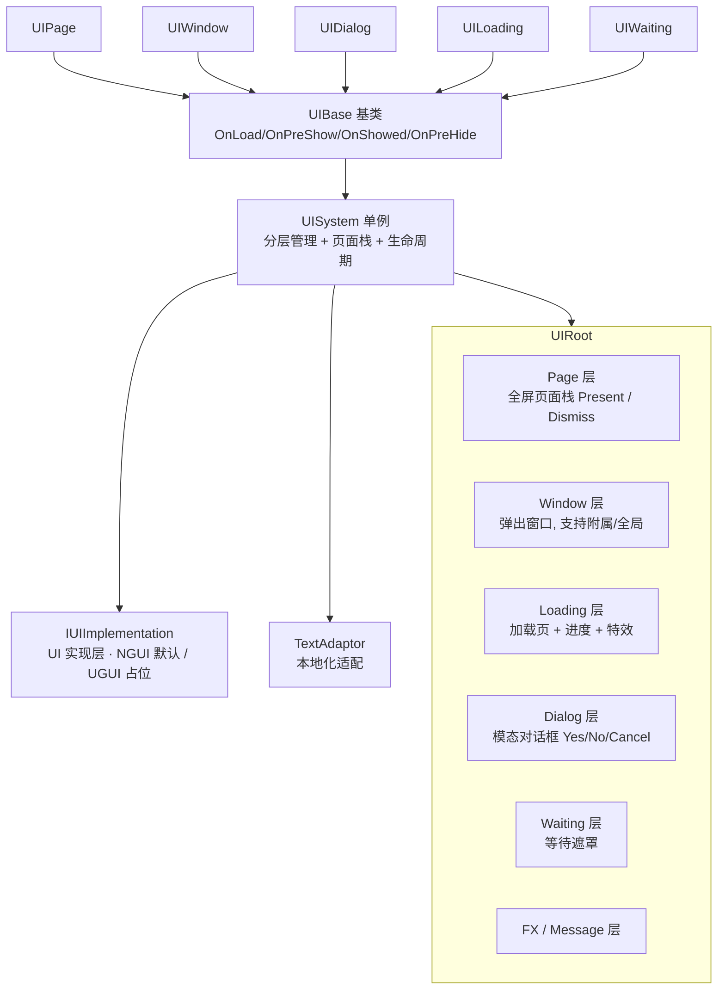
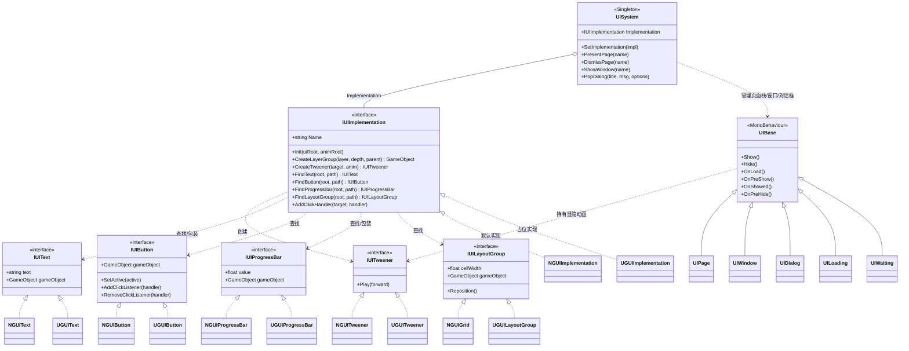

# GGUI (内测版)

Unity 游戏客户端 UI 框架，提供可插拔控件接口、分层管理、栈式页面导航以及窗口、对话框、加载和等待组件，默认使用 NGUI。

[](https://github.com/gonglei007/GGFramework-GGUI/blob/master/GGUI/ProjectSettings/ProjectVersion.txt) [](https://github.com/gonglei007/GGFramework-Core/tree/v0.1.1) [](https://github.com/gonglei007/GGFramework-GGUI/tree/master)

## 项目导航

[Demo 体验](https://github.com/gonglei007/GGFramework-Demo) · [架构文档](https://github.com/gonglei007/GGFramework-Docs) · [Core](https://github.com/gonglei007/GGFramework-Core) · [GGResource](https://github.com/gonglei007/GGFramework-GGResource) · [GGNetwork](https://github.com/gonglei007/GGFramework-GGNetwork) · **GGUI** · [GGUser](https://github.com/gonglei007/GGFramework-GGUser)

> **先体验整体框架**：[打开独立 Demo](https://github.com/gonglei007/GGFramework-Demo#快速开始)，体验资源、HTTP、UI、用户 SDK 与 Lua 的集成流程。[操作指南](https://github.com/gonglei007/GGFramework-Demo/blob/main/documents/showcase-guide.md) · [验收记录](https://github.com/gonglei007/GGFramework-Demo/blob/main/documents/showcase-verification.md)。

## 模块关系

本工程通过 UPM 固定使用 **Core v0.1.1**，`Dependency` 中包含资源实现副本；UI 控件经 `Abstraction` 与后端解耦。NGUI 为现有实现，UGUI 目录是待补全的占位骨架。Demo 的旧 UI 集成副本用于体验页面流程，当前接口层以本仓库为准。

完整依赖图、工程锁定版本和源码副本边界由[架构文档中心](https://github.com/gonglei007/GGFramework-Docs#模块关系)统一维护。

## 快速开始

在准备存放代码的目录运行：

```powershell
git clone https://github.com/gonglei007/GGFramework-GGUI.git
# 在 Unity Hub 中打开 GGFramework-GGUI/GGUI
```

1. 用 Unity **6000.3.13f1** 打开 `GGUI` 工程。GitHub 默认维护分支为 **master**。
2. 从[集成 Demo 的 UI 页](https://github.com/gonglei007/GGFramework-Demo/blob/main/documents/showcase-guide.md)体验页面入栈 / 返回、窗口归属与关闭，再查看本模块 [Demo.unity](GGUI/Assets/Demo/Demo.unity) 和[演示脚本](GGUI/Assets/Demo/Scripts/Demo.cs)。
3. 接入时按[快速接入指南](documents/quickstart.md)准备框架、Dependency、NGUI 和资源依赖，建立 Tag 为 `UIRoot` 的根对象。
4. 本模块旧示例依赖 Game / 通用 UI 资源。先初始化资源、加载框架 UI 并调用 `CreateFrameworkUIs`，再使用页面、窗口或对话框；完整顺序与资源准备见接入指南。

## 简介

GGUI 是一个面向游戏客户端的 UI 框架。它把控件能力抽象为 **UI 接口层**（`Abstraction/`：`IUIImplementation` / `IUIButton` / `IUIText` / `IUITweener` / `IUIProgressBar` / `IUILayoutGroup`），底层实现可插拔——当前**默认提供 NGUI 实现**（`Implementation/NGUI/`），并预置 **UGUI 占位实现**（`Implementation/UGUI/`，骨架待补全）。它提供分层的 UI 管理、栈式页面导航、通用窗口/对话框/加载组件，以及丰富的控件扩展库，帮助团队快速、稳定地搭建游戏界面层，并可与 GGResource（资源）、GGNetwork（网络）等 GG 框架模块组合使用。

### 架构示意



> **8 层 UI**：Page / Window / UIFX / Loading / Dialog / Message / Waiting，每层有独立排序深度；`UIBase` 统一生命周期，`ResourceSystem` 异步加载页面 Prefab。

### UI 接口层类图

核心层只依赖 `Abstraction/` 的 6 个引擎无关接口；`UISystem` 持有一个 `IUIImplementation`（默认 `NGUIImplementation`，可注入 `UGUIImplementation`），由它创建/查找各类控件抽象；`UIBase` 及其派生类通过实现层拿到 `IUITweener` 播放显隐动画。切换 UI 后端时业务侧无需改动。



> 图以 **mermaid** 内嵌维护（GitHub 原生渲染，改图即改文本）。图表格式约定见 GGFramework-Docs `architecture/architecture-diagram.md` §5。

## 功能与特性

**分层 UI 管理**

- 内置 **8 层 UI**（Page / Window / FX / Loading / Dialog / Message / Waiting），每层独立排序深度，运行时在 UIRoot 下自动按层建组并挂载 `UIPanel`
- 通过 `UILayer` 枚举 + `UIPanel.depth` / `sortingOrder` 控制界面层级

**栈式页面导航**

- 全屏页面堆栈管理：支持 `PresentPage`（入栈显示）/ `DismissPage`（出栈）/ 弹出到指定页 / 清空
- 页面切换时自动隐藏当前页、回收附属窗口与对话框

**窗口与通用组件**

- **窗口系统**：支持全局窗口与页面附属窗口，页面切换自动回收
- **模态对话框**：可配置 Yes / No / Cancel 按钮位掩码、遮罩点击、按钮自动布局
- **加载页**：进度条、提示文本定时轮播、进场 / 退场 / 完整转场特效
- **等待 UI**：短时延迟遮罩（默认 2 秒）

**UI 生命周期与动画**

- 生命周期钩子：`OnLoad` / `OnPreShow` / `OnShowed` / `OnPreHide`，支持注入式显隐动画与特效
- 基于 NGUI `UITweener` 的动画工厂：按名复用 / 拷贝补间动画组件到任意 UI

**资源异步联动**

- 基于 Loxodon AssetBundle 的 `ResourceSystem`：异步加载页面，资源就绪后自动执行待加载动作（如 `PresentPage`）
- 支持下载优先级调整与编辑器模拟模式（不打 Bundle 即可调试）

**控件扩展库（NGUIExtend）**

- 窗口 Show / Close 动画（淡入淡出 / 缩放 / 飞入飞出）、抖动 / 旋转 / 闪烁 / 缩放特效
- 按钮多状态贴图、置灰 Sprite、焦点导航（键盘 / 手柄）、表情图集管理、渲染队列控制

**本地化与工具**

- `TextAdaptor` 解耦文本系统，`UILabelLocalization` 组件按 key 绑定本地化文本
- 组件跨对象复制、路径自动绑定、屏幕调试日志 + FPS 计数器、协程工具

## 工程内容

<table>
    <tr><th>目录</th><th>内容</th><th>说明</th></tr>
    <tr>
        <td>GGUI/Assets/Scripts/GGUI</td>
        <td>框架代码</td>
        <td>可以直接复制到目标工程中使用（需另加 GGFramework.Core UPM 依赖，见「依赖」）。</td>
    </tr>
    <tr>
        <td>GGUI/Assets/Demo</td>
        <td>演示工程</td>
        <td>可以作为框架使用的参考。</td>
    </tr>
</table>

## 依赖

* **GGFramework.Core** — `Singleton` / `CoroutineUtil` 等基础类的单一源，经 UPM git URL 引用（`#v0.1.1`）；工程内原本地 `Singleton.cs` / `CoroutineUtil.cs` 副本已删除（`Dependency/Utils/` 现仅剩 `GameDebugger`）
* **NGUI** — 默认 UI 底层实现依赖的控件系统（位于 `Assets/LocalPackages`）；经 `Abstraction/` 接口层解耦，可替换为 UGUI 等实现
* **Loxodon Framework** — AssetBundle 资源加载底层（位于 `Assets/LocalPackages`）
* **SimpleJson** — 轻量 JSON 序列化辅助

## 核心类速览

| 类 | 说明 |
| --- | ---- |
| `UISystem` | 核心总控（单例）：分层管理、页面栈、窗口/对话框/加载/等待管理 |
| `UIBase` | 所有 UI 基类，提供生命周期钩子与显隐动画流程 |
| `UIPage` / `UIWindow` / `UIDialog` / `UILoading` / `UIWaiting` | 开箱即用的派生 UI 类型 |
| `IUIImplementation`（`Abstraction/`） | UI 底层实现抽象接口；`NGUIImplementation`（默认）/ `UGUIImplementation`（占位）分别实现 |
| `IUIButton` / `IUIText` / `IUITweener` / `IUIProgressBar` / `IUILayoutGroup`（`Abstraction/`） | 引擎无关控件抽象；各有 `NGUI*`（默认）与 `UGUI*`（占位）两套实现 |

## 文档

* [如何快速接入?](documents/quickstart.md)
* [技术手册](documents/manual.md)

## 进群沟通

| | | |
| --- | -------- | -------- |
| QQ群: | 242500383 | [](https://qm.qq.com/cgi-bin/qm/qr?k=fy4Z65nE-5Jd1ay8FkJpDc9iPJyW3d38&jump_from=webapi) |

## TODO-List

* 更完整的 Demo 演示
* 补全 UGUI 占位实现（`Implementation/UGUI/`），使 UI 接口层可脱离 NGUI 运行

## 更多资料

* [游戏开发图谱](https://github.com/gonglei007/GameDevMind)
  * [UI界面](https://github.com/gonglei007/GameDevMind/blob/main/mds/1.2.2.%E7%95%8C%E9%9D%A2%E4%B8%8EUI.md)

## 自动化 Unity 回归与 CI

本仓契约：[ci/unity-regression.json](ci/unity-regression.json)。现有 EditMode 至少 11 项；不将资源模型测试外推为完整 NGUI/UGUI 或页面栈集成验收。

共享执行器按 [Demo `6fba3a3`](https://github.com/gonglei007/GGFramework-Demo/tree/6fba3a32aae1951df8dd034dd15f36a36ab25895/tools/ci) 固定复用，保持本模块运行时依赖不变。[本地命令、一次性 Windows runner、触发规则、artifact 与边界](https://github.com/gonglei007/GGFramework-Demo/blob/6fba3a32aae1951df8dd034dd15f36a36ab25895/tools/ci/README.md)统一维护。分支 push 会排队真实 Unity job，PR 托管契约检查不能代替 Unity；没有 runner 时不会计为 Unity 通过。每轮结束后注销 runner，不安装服务、不上传 Unity 授权。
