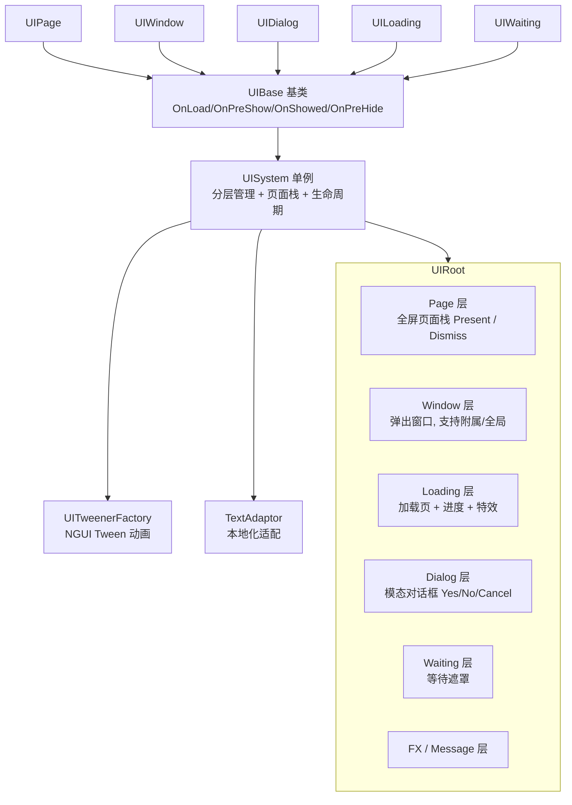

  <h1 align="center">GGUI (内测版)</h1>
  

    
    
    
    
  

  
一个抽象 UI 接口层、底层实现可插拔（默认 NGUI）的游戏客户端 UI 框架

## 简介

GGUI 是一个面向游戏客户端的 UI 框架。它把控件能力抽象为 **UI 接口层**（`Abstraction/`：`IUIImplementation` / `IUIButton` / `IUIText` / `IUITweener` / `IUIProgressBar` / `IUILayoutGroup`），底层实现可插拔——当前**默认提供 NGUI 实现**（`Implementation/NGUI/`），并预置 **UGUI 占位实现**（`Implementation/UGUI/`，骨架待补全）。它提供分层的 UI 管理、栈式页面导航、通用窗口/对话框/加载组件，以及丰富的控件扩展库，帮助团队快速、稳定地搭建游戏界面层，并可与 GGResource（资源）、GGNetwork（网络）等 GG 框架模块组合使用。

### 架构示意

> **8 层 UI**：Page / Window / UIFX / Loading / Dialog / Message / Waiting，每层有独立排序深度；`UIBase` 统一生命周期，`ResourceSystem` 异步加载页面 Prefab。

## 功能与特性

**分层 UI 管理**

- 内置 **8 层 UI**（Page / Window / FX / Loading / Dialog / Message / Waiting），每层独立排序深度，运行时在 UIRoot 下自动按层建组并挂载 `UIPanel`
- 通过 `UILayer` 枚举 + `UIPanel.depth` / `sortingOrder` 控制界面层级

**栈式页面导航**

- 全屏页面堆栈管理：支持 `PresentPage`（入栈显示）/ `DismissPage`（出栈）/ 弹出到指定页 / 清空
- 页面切换时自动隐藏当前页、回收附属窗口与对话框

**窗口与通用组件**

- **窗口系统**：支持全局窗口与页面附属窗口，页面切换自动回收
- **模态对话框**：可配置 Yes / No / Cancel 按钮位掩码、遮罩点击、按钮自动布局
- **加载页**：进度条、提示文本定时轮播、进场 / 退场 / 完整转场特效
- **等待 UI**：短时延迟遮罩（默认 2 秒）

**UI 生命周期与动画**

- 生命周期钩子：`OnLoad` / `OnPreShow` / `OnShowed` / `OnPreHide`，支持注入式显隐动画与特效
- 基于 NGUI `UITweener` 的动画工厂：按名复用 / 拷贝补间动画组件到任意 UI

**资源异步联动**

- 基于 Loxodon AssetBundle 的 `ResourceSystem`：异步加载页面，资源就绪后自动执行待加载动作（如 `PresentPage`）
- 支持下载优先级调整与编辑器模拟模式（不打 Bundle 即可调试）

**控件扩展库（NGUIExtend）**

- 窗口 Show / Close 动画（淡入淡出 / 缩放 / 飞入飞出）、抖动 / 旋转 / 闪烁 / 缩放特效
- 按钮多状态贴图、置灰 Sprite、焦点导航（键盘 / 手柄）、表情图集管理、渲染队列控制

**本地化与工具**

- `TextAdaptor` 解耦文本系统，`UILabelLocalization` 组件按 key 绑定本地化文本
- 组件跨对象复制、路径自动绑定、屏幕调试日志 + FPS 计数器、协程工具

## 工程内容

<table>
    <tr><th>目录</th><th>内容</th><th>说明</th></tr>
    <tr>
        <td>GGUI/Assets/Scripts/GGUI</td>
        <td>框架代码</td>
        <td>可以直接复制到目标工程中使用（需另加 GGFramework.Core UPM 依赖，见「依赖」）。</td>
    </tr>
    <tr>
        <td>GGUI/Assets/Demo</td>
        <td>演示工程</td>
        <td>可以作为框架使用的参考。</td>
    </tr>
</table>

## 依赖

* **GGFramework.Core** — `Singleton` / `CoroutineUtil` 等基础类的单一源，经 UPM git URL 引用（`#v0.1.1`）；工程内原本地 `Singleton.cs` / `CoroutineUtil.cs` 副本已删除（`Dependency/Utils/` 现仅剩 `GameDebugger`）
* **NGUI** — 默认 UI 底层实现依赖的控件系统（位于 `Assets/LocalPackages`）；经 `Abstraction/` 接口层解耦，可替换为 UGUI 等实现
* **Loxodon Framework** — AssetBundle 资源加载底层（位于 `Assets/LocalPackages`）
* **SimpleJson** — 轻量 JSON 序列化辅助

## 核心类速览

| 类 | 说明 |
| --- | ---- |
| `UISystem` | 核心总控（单例）：分层管理、页面栈、窗口/对话框/加载/等待管理 |
| `UIBase` | 所有 UI 基类，提供生命周期钩子与显隐动画流程 |
| `UIPage` / `UIWindow` / `UIDialog` / `UILoading` / `UIWaiting` | 开箱即用的派生 UI 类型 |
| `IUIImplementation`（`Abstraction/`） | UI 底层实现抽象接口；`NGUIImplementation`（默认）/ `UGUIImplementation`（占位）分别实现 |

## 文档

* [如何快速接入?](/documents/quickstart.md)
* [技术手册](/documents/manual.md)

## 进群沟通

| | | |
| --- | -------- | -------- |
| QQ群: | 242500383 |  |

## TODO-List

* 更完整的 Demo 演示
* 补全 UGUI 占位实现（`Implementation/UGUI/`），使 UI 接口层可脱离 NGUI 运行

## 更多资料

* [游戏开发图谱](https://github.com/gonglei007/GameDevMind)
  * [UI界面](https://github.com/gonglei007/GameDevMind/blob/main/mds/1.2.2.%E7%95%8C%E9%9D%A2%E4%B8%8EUI.md)
